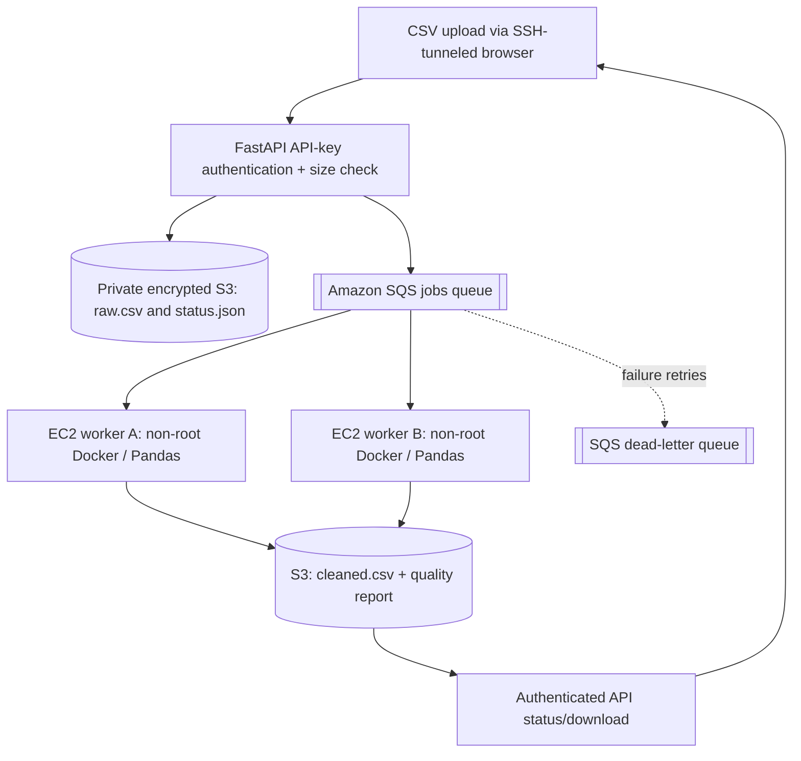
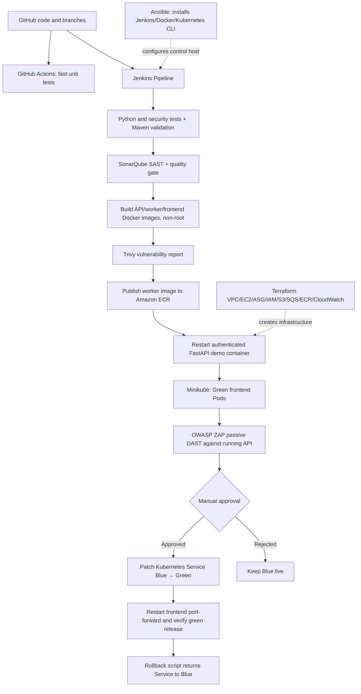

# DataPrepOps v2 — Architecture

## Data-processing flow

## Provision, build, secure and deploy

## Security controls

- The AWS control security group exposes **SSH port 22 only to a single admin CIDR**. All web consoles are accessed through SSH local port-forwarding, including Jenkins, the application, SonarQube and Grafana.
- AWS worker instances have **zero inbound security-group rules**, though their public IPv4 enables inexpensive package/ECR outbound access in this classroom design.
- EC2 instance IAM profiles avoid static AWS access keys. The control role can send jobs and push ECR images; the worker role consumes queue messages and reads/writes the project bucket.
- S3 blocks public access, encrypts objects at rest and rejects non-TLS S3 requests. All EC2 root disks are encrypted and IMDSv2 is required.
- API job endpoints require `X-Demo-API-Key`, stored in Jenkins Secret text and passed at runtime. The local browser holds the key in memory for the session. Input size/type, invalid IDs, CORS and response headers are tested.
- All three project images run as Linux UID/GID 10001. Kubernetes frontend Pods additionally use `runAsNonRoot`, read-only root filesystem, RuntimeDefault seccomp, `allowPrivilegeEscalation=false`, and drop capabilities.
- Kubernetes namespace includes read-only Pod RBAC and demo-only Secret. The frontend Pod has service-account-token automount disabled. Demonstrating a Kubernetes Secret is **not** equivalent to the production API key being stored in Kubernetes: the API runs outside Minikube.
- SonarQube examines source before image builds; Trivy reports package vulnerabilities in built images; ZAP baseline passively scans the running API. Vulnerability findings are **not** automatically remediated or hidden.
- Prometheus/Grafana shows service and auth status. Alertmanager receives Prometheus alerts; CloudWatch queue metrics and SNS handle infrastructure alarms and Auto Scaling steps.

## Separation of scaling concerns

- Auto Scaling Group: 2 minimum, 2 desired, 3 maximum *EC2 worker instances*. Each pulls an SQS job, calls Pandas code, and uploads results to S3.
- Kubernetes: Blue (2 Pods) and Green (2 Pods) **frontend containers inside one Minikube control VM**. They are not three EC2 Kubernetes worker nodes.
- Minikube Blue/Green is a deployment/recovery **demonstration**, not a zero-downtime guarantee. A long-lived `kubectl port-forward` needs restarting after selector changes.

## Cloud limitations

No NAT gateway, multi-node EKS control plane, ALB, TLS public load balancer, database, production KMS keys or HA controller. These are excluded to control cost and complexity; do not claim production high availability, regulatory certification or zero vulnerabilities.
